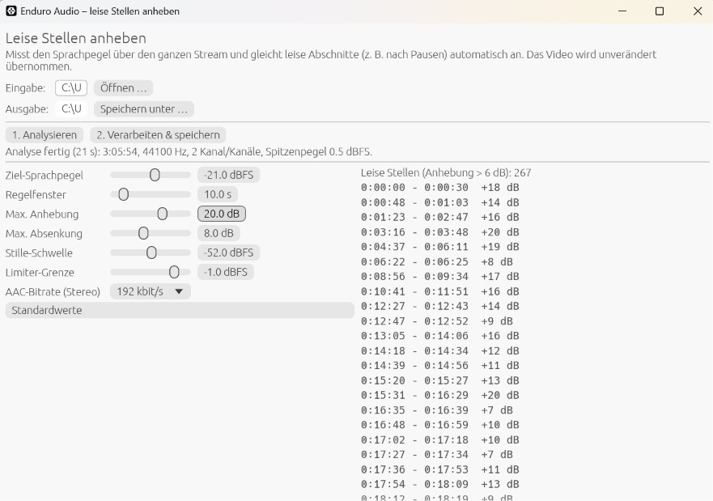

# Enduro Audio

**Leise Stellen in Livestream-Aufnahmen automatisch anheben.**

Enduro Audio ist ein Windows-Programm: eine einzelne `.exe`, die ohne Installation läuft. Es gleicht in Livestream-Aufzeichnungen (MP4) leise Abschnitte an, zum Beispiel nach Pausen. Das Video wird unverändert übernommen. Nur die Tonspur wird bearbeitet und neu kodiert.



## Download / Start

`target/x86_64-pc-windows-gnu/release/enduroaudio.exe` herunterladen und per Doppelklick starten. Es sind keine Installation und keine zusätzlichen DLLs nötig.

## Bedienung

1. Mit **Öffnen …** eine MP4-Datei wählen oder die Datei ins Fenster ziehen. Die Ausgabedatei wird automatisch vorgeschlagen (`<name>_laut.mp4`).
2. **1. Analysieren** anklicken. Das Programm misst den Pegel der gesamten Datei und zeigt danach den Pegelverlauf und die erkannten leisen Stellen an.
3. Bei Bedarf die Regler anpassen. Diagramm und Liste aktualisieren sich sofort, ohne neue Analyse.
4. **2. Verarbeiten & speichern** anklicken. Es entsteht eine neue MP4-Datei, das Original bleibt unverändert.

## Einstellungen

| Regler | Standard | Bedeutung |
|---|---|---|
| Ziel-Sprachpegel | −21 dBFS | Auf diesen Pegel wird die Sprache geregelt (RMS ohne Pausen) |
| Regelfenster | 10 s | Zeitraum, über den der Pegel gemittelt wird. Kürzer gleicht schneller aus, ebnet aber auch die Betonung innerhalb von Sätzen stärker ein |
| Max. Anhebung | 20 dB | Obergrenze der Anhebung |
| Max. Absenkung | 8 dB | Obergrenze der Absenkung zu lauter Stellen |
| Stille-Schwelle | −52 dBFS | Was leiser ist, gilt als Pause und wird nicht hochgezogen |
| Limiter-Grenze | −1 dBFS | Spitzen werden darauf begrenzt, damit nichts übersteuert |
| AAC-Bitrate | 192 kbit/s | Qualität der neuen Tonspur (Stereo; Mono erhält die Hälfte) |

## Wie der Filter funktioniert

Das Verfahren wurde aus der Analyse eines echten Enduro-Rene-Livestreams abgeleitet (3 h 06 min, AAC 44,1 kHz). Dort gab es zwei Probleme:

- **kurze, sehr leise Passagen** (10–80 s, bis zu 20 dB leiser), typischerweise direkt nach einer Unterbrechung;
- **langsame Pegeldrifts** über viele Minuten (etwa ±4 dB).

Ein normaler Kompressor oder eine automatische Lautstärkeregelung reagiert immer verzögert. Gerade nach einer Pause ist der Ton dann erst einige Sekunden zu leise. Enduro Audio analysiert deshalb zuerst die ganze Datei und regelt danach **vorausschauend**:

1. **Messung:** Die Energie wird für jeden 50-ms-Abschnitt gemessen, nach einem 80-Hz-Hochpass.
2. **Sprachpegel:** Für jeden Zeitpunkt wird der mittlere Pegel aller aktiven Abschnitte in einem gaußförmigen Fenster *um* diesen Zeitpunkt berechnet. Stille und Geräusche mehr als 20 dB unter dem lokalen Pegel werden ignoriert.
3. **Verstärkung:** Die Verstärkung ist Zielpegel minus Sprachpegel. Sie wird begrenzt und über 1 s geglättet. Weil das Fenster auch in die Zukunft schaut, stimmt sie nach einer Pause sofort.
4. **Limiter:** Ein Lookahead-Limiter (5 ms Vorlauf, 150 ms Release) fängt Spitzen ab.
5. **Ausgabe:** Die Tonspur wird mit FDK AAC neu kodiert. Die Videospur wird bitgenau kopiert.

In der Beispielaufnahme sank die Schwankung des Sprachpegels (in 30-s-Blöcken) von ±3 dB auf ±0,4 dB. Die Verarbeitung von drei Stunden dauerte auf dem Testrechner gut zwei Minuten.

## Einschränkungen

- Eingabe: MP4/M4A/M4V/MOV mit AAC-Tonspur. Fragmentierte MP4-Dateien werden nicht unterstützt.
- Bearbeitet wird die erste Tonspur. Weitere Tonspuren werden nicht übernommen.
- Hintergrundgeräusche in leisen Passagen werden mit angehoben. Bei Bedarf die maximale Anhebung reduzieren.

## Selbst bauen

Gebaut wird unter Linux oder WSL mit Rust und MinGW:

```sh
rustup target add x86_64-pc-windows-gnu
sudo apt install gcc-mingw-w64-x86-64 g++-mingw-w64-x86-64
cargo build --release --target x86_64-pc-windows-gnu
```

Ergebnis: `target/x86_64-pc-windows-gnu/release/enduroaudio.exe`. Die Datei ist statisch gelinkt.

Eine Kommandozeilenversion ohne Oberfläche (z. B. für Linux) entsteht so:

```sh
cargo build --release --no-default-features
./target/release/enduroaudio --cli eingabe.mp4 [ausgabe.mp4]
```

`vendor/fdk-aac-sys` enthält eine Kopie des Crates `fdk-aac-sys` 0.5 mit einem kleinen Fix in `common_fix.h`. Ohne diesen Fix kompiliert fdk-aac nicht mit MinGW.

## Aufbau

| Datei | Inhalt |
|---|---|
| `src/dsp.rs` | Pegelmessung, Verstärkungskurve, Limiter |
| `src/media.rs` | Dekodieren (Symphonia), Verarbeitungs-Pipeline, AAC-Encoder |
| `src/mux.rs` | MP4 lesen/schreiben, Videospur unverändert kopieren |
| `src/gui.rs` | Oberfläche (egui/eframe) |
| `src/main.rs` | Einstieg, Kommandozeilenmodus |
